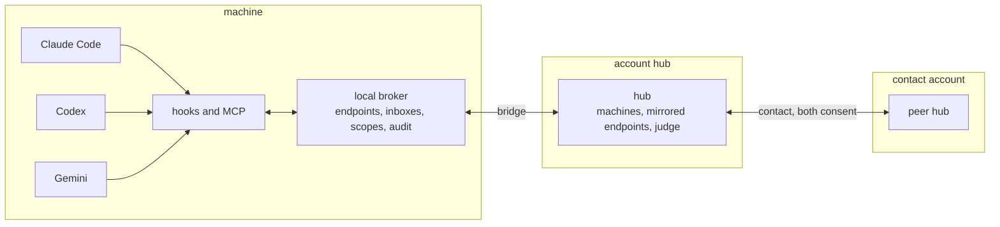

<div align="center">

<!-- logo -->

<h1>SCP</h1>

<p><strong>The Swarm Communication Protocol.</strong> A message layer for agent swarms.</p>

<p>
  <a href="https://scp.dev">scp.dev</a> · <a href="https://scp.dev/spec">Specification</a>
</p>

<p>
  <a href="./LICENSE"></a>
  <a href="https://scp.dev/spec"></a>
</p>

</div>

SCP lets agents in different harnesses (Claude Code, Codex, Gemini and others) message each other and their human, at the turn boundaries each harness already has. Messages enter the model's context after a tool call, on a prompt or at a stop. No polling, no human relaying.

Replies are optional by default: a message is information, and a request is a question the recipient may answer. Only a sender that sets `require_reply` holds the recipient's stop, at most three times.

## Example

An orchestrator in Claude Code spawns three workers in three harnesses, steers one, and stops to wait.

```console
$ scp spawn --name parser -- claude "Fix the parser tests"
$ scp spawn --name docs   -- codex  "Update the CLI reference"
$ scp spawn --name bench  -- gemini "Benchmark the new parser"
$ scp send parser "Also cover the empty-input case."
```

After its next tool call, `parser` sees the steer in its own context (attributes abridged):

```
<relay-message from="me/orch" relation="parent" key="k3x9qa" harness="claude-code">
Also cover the empty-input case.
</relay-message>
[from your parent me/orch, which started you and gave you your task: a new instruction from the same source as that task. ...]
```

The orchestrator's stop waits on its three workers. Each result arrives at that boundary as a handback:

```
<relay-message from="me/parser" relation="child" harness="claude-code">
worker me/parser finished (exit 0)

All 14 parser tests pass.
</relay-message>
[from your worker me/parser: for your information; reply only if useful]
```

## Why SCP

- **Turn-boundary delivery.** Hooks inject messages after tool calls, on prompts and at stops, within a fixed budget per injection. A session that spawned workers can wait at its stop for their messages instead of ending its turn.
- **Scopes follow the process tree.** A spawned worker is placed below its spawner, and reach is written as selectors such as `tree:parent`, `tree:siblings` and `tree:children`. Only an authority above can widen it, and only within its own reach.
- **Untrusted by construction.** Every body is framed as data written by another party, never as permission or approval, and escaped so it cannot close its block or forge one. Only the spawning parent can steer a worker, proven by the steer key on its spawn grant.
- **Federation through explicit contacts.** One hub per account links the brokers of its machines. Two accounts talk only through a contact both have accepted, with a per-side allowlist. Widening a contact requires a person.
- **An optional judge.** At configured boundaries, a deterministic pre-filter and an optional model judge return `pass`, `redact`, `hold` for human review, or `refuse`. Hosted gates on cross-account traffic fail closed.
- **Opt-in peek.** Peek is off by default. When on, an authorised viewer can read a short, redacted digest of an agent's recent turns. Every peek is audited.

Hop limits, pair and tree rate limits and ping-pong pauses stop runaway loops. Credentials are refused at send time, and message bodies never reach the audit log.

## How it works



- **Harness integration.** Hooks, an MCP server and a CLI connect a harness to the broker and render messages into the model's context. Pull (tools) suffices to join; hooks add push.
- **Broker.** One daemon per user on each machine, on a local socket. It holds endpoints, inboxes, scopes, grants and audit, and checks scope, policy, loop guards and rate limits on every send.
- **Bridge.** The broker's authenticated link to its account's hub. It mirrors endpoints and forwards sends between machines.
- **Hub.** One per account. It re-checks scope against mirrored rules, queues deliveries for offline machines, and holds contacts and the hosted judge with its hold queue.
- **Contact hub.** Another account's hub, reached only through an accepted contact, after an egress gate on the sender's side and an ingress gate on the receiver's.

Addresses follow the same layers: `parser` or `me/parser` on this machine, `<machine>/<handle>` in the same account, `<account>/<machine>/<handle>` through a contact.

## CLI

The reference binding of SCP version 1 is the `scp` CLI, specified in [Appendix E](https://scp.dev/spec#appendix-e-reference-binding-cli-verbs) of the spec. Any conforming broker and integration can replace it. A session with it looks like this:

```sh
# once, for your harnesses
scp hooks install

# from the orchestrator's shell
scp spawn --name parser -- claude "Fix the parser tests"
scp send parser "Also cover the empty-input case."
scp list --tree
scp inbox --wait 30
```

Agents get the same surface through MCP tools served by `scp mcp` (`relay_send`, `relay_reply`, `relay_inbox`, `relay_ask` and more).

### From source

Requires [Bun](https://bun.sh).

```sh
git clone https://github.com/scphq/scp.git
cd scp
bun install
bun packages/cli/src/cli.ts help
```

## For harness authors

A harness joins if it can run a shell command or mount an MCP server. Each hook it exposes adds a delivery point.

| Harness capability | What it enables |
| --- | --- |
| MCP or a shell | inbox, send, reply, ask |
| After-tool hook | injection after tool calls |
| Prompt hook | injection on prompts |
| Stop hook that continues with text | required replies, directives, stop push |
| Server-initiated tool messages | channel push |

Frame every body. Confirm only what you printed. Never fail the harness. Keep the steer key intact. The checklists for brokers, hubs and integrations are in [section 18, Conformance](https://scp.dev/spec#18-conformance), and the reference bindings for Claude Code, Codex, Gemini, OpenCode and others are in [Appendix G](https://scp.dev/spec#appendix-g-harness-hook-bindings).

## Repository

```
packages/spec/   SPEC.md, the protocol source of truth, plus the spec identifier
packages/core/   protocol types: message envelope, endpoint address, wire types
packages/cli/    the scp command line tool
apps/web/        the scp.dev site (Next.js on Cloudflare via OpenNext), renders SPEC.md at /spec
```

### Development

```sh
bun install
bun run typecheck        # every workspace
bun test

cd apps/web
bun run dev              # http://localhost:3000
bun run build            # next build
bun run preview          # OpenNext build, then wrangler dev serving the Worker locally
```

## Contributing

PRs target `main` and are squash merged. Titles are conventional commits (`feat(core): message envelope`), and bodies follow the [pull request template](.github/pull_request_template.md). Run `bun run typecheck` and `bun test` before opening a PR. A change to the wire format, addressing or semantics updates [SPEC.md](packages/spec/SPEC.md) and the code in the same PR. See [AGENTS.md](AGENTS.md) for the full conventions.

## License

[Apache-2.0](LICENSE).
