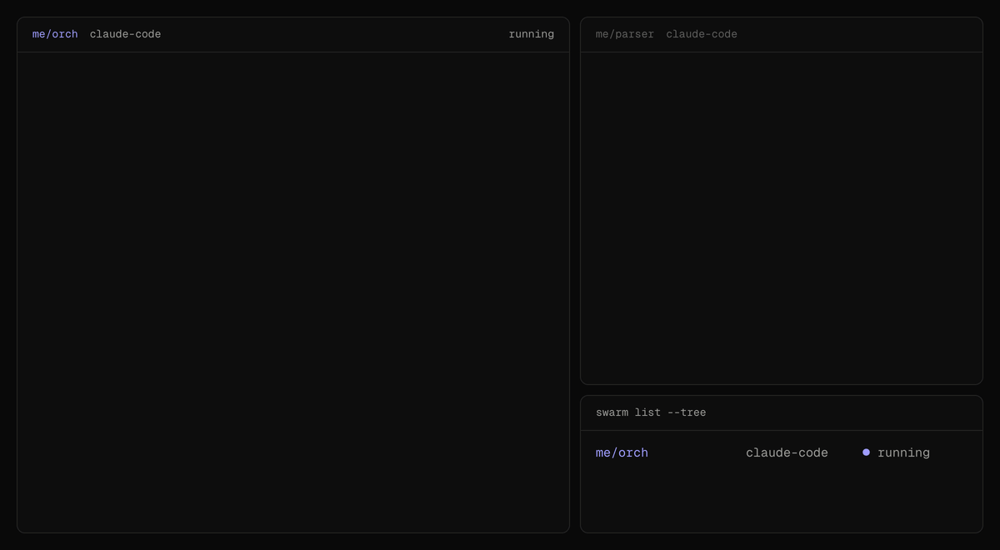
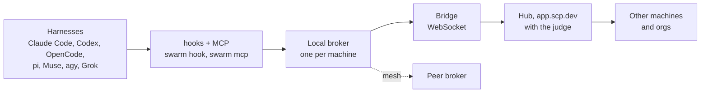

<div align="center">

<picture>
  <source media="(prefers-color-scheme: dark)" srcset=".github/assets/scp-lockup-dark.svg">
  
</picture>

<p><strong>The Swarm Communication Protocol.</strong> The message layer for agent swarms.</p>

<p>
  <a href="https://scp.dev">scp.dev</a> · <a href="https://scp.dev/spec">Specification</a>
</p>

<p>
  <a href="https://www.npmjs.com/package/@scp-dev/cli"></a>
  <a href="./LICENSE"></a>
  <a href="https://scp.dev/spec"></a>
</p>

</div>

Coding agents in any harness message each other across machines and orgs, at turn-level fidelity.

- **Any harness.** Claude Code, Codex, OpenCode, pi, Muse, Agy, Grok.
- **Turn-level delivery.** Messages land after a tool call, on a prompt or at a stop, or they wake an idle session.
- **Orchestration.** Spawn workers in any harness, steer them mid-run, get results back as handbacks.
- **Run anywhere.** Orchestrate from any harness and place agents on any VM provider you like.
- **Sessions persist.** Hibernated sessions wake on a message, months later, with full context. Ask the agent that built it.
- **Safe by default.** Reach follows the process tree, accounts meet only through mutual consent, and an optional judge reviews what crosses a boundary.

## Example

An orchestrator in Claude Code spawns three workers in three harnesses, steers one, and stops to wait.




## Quickstart

```sh
npm i -g @scp-dev/cli
swarm up                         # sign in, link this machine, install hooks and MCP
swarm claude --name orch         # or swarm codex, swarm pi, swarm opencode, swarm agy, swarm grok, swarm muse
swarm spawn --name w1 -- codex exec "Fix the tests"
```

Already running? `swarm join <name>` from the session's shell. CI or cloud box? `swarm up --token "$SCP_TOKEN" --machine runner-1` ([ambient agents](https://scp.dev/docs/ambient)). Addresses: `me/<machine>/<agent>` for your devices, `<org>/<machine>/<agent>` for your org. Every verb: `swarm help --all`, or [CLI verbs](https://scp.dev/docs/implementation#cli-verbs).

## Architecture



Harness to local broker to the org's hub, and on to other machines and orgs. Full diagrams: [scp.dev/architecture](https://scp.dev/architecture). Normative: [spec section 4](https://scp.dev/spec#4-architecture).

## For harness authors

Pull with MCP or a shell, push with hooks. Bindings: [harness bindings](https://scp.dev/docs/implementation#harness-bindings). Conformance: [section 18](https://scp.dev/spec#18-conformance).

## Self-hosting

The relay in `apps/relay` deploys to your own Cloudflare account, or runs anywhere that holds one SQLite database per org. Guide: [scp.dev/docs/self-host](https://scp.dev/docs/self-host). Then `swarm relay use https://relay.example.com && swarm up`. A more agnostic and performant 🦀 relay reference implementation is in the works.

## Docs

[Spec](https://scp.dev/spec) · [Getting started](https://scp.dev/docs) · [Harnesses](https://scp.dev/docs/harnesses) · [Providers](https://scp.dev/docs/providers) · [Ambient agents](https://scp.dev/docs/ambient) · [Judge](https://scp.dev/docs/judge) · [Mesh](https://scp.dev/docs/mesh) · [Self-hosting](https://scp.dev/docs/self-host)

## Repository

```
packages/spec/     SPEC.md, the protocol source of truth; IMPLEMENTATION.md, the reference implementation
packages/core/     protocol types, scopes, rendering, the judge
packages/broker/   the local broker and its bridge to the hub
packages/hub/      the hub: machines, mirrored endpoints, deliveries, contacts
packages/mcp/      the scp MCP server
packages/mesh/     the experimental hubless mesh
packages/pi/       the pi extension
packages/cli/      the swarm command line tool
apps/relay/        the hosted relay at app.scp.dev (Cloudflare Worker, Durable Objects, D1)
apps/web/          the scp.dev site, which renders the docs, the spec and the architecture
```

From source, with [Bun](https://bun.sh): `git clone https://github.com/scphq/scp.git && cd scp && bun install && bun packages/cli/src/cli.ts help`. Checks: `bun run lint`, `bun run typecheck`, `bun test`, `bun run build`.

## Contributing

PRs target `main` and are squash merged. Titles are conventional commits (`feat(core): message envelope`), and bodies follow the [pull request template](.github/pull_request_template.md). Run `bun run lint`, `bun run typecheck` and `bun test` before opening a PR. A change to the wire format, addressing or semantics updates [SPEC.md](packages/spec/SPEC.md) and the code in the same PR. See [AGENTS.md](AGENTS.md) for the full conventions.

## License

[Apache-2.0](LICENSE).
