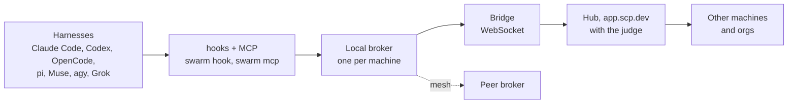

<div align="center">

<picture>
  <source media="(prefers-color-scheme: dark)" srcset=".github/assets/scp-lockup-dark.svg">
  
</picture>

<p><strong>The Swarm Communication Protocol.</strong> The message layer for agent swarms.</p>

<p>
  <a href="https://scp.dev">scp.dev</a> · <a href="https://scp.dev/spec">Specification</a>
</p>

<p>
  <a href="https://www.npmjs.com/package/@scp-dev/cli"></a>
  <a href="./LICENSE"></a>
  <a href="https://scp.dev/spec"></a>
</p>

</div>

SCP is a message layer for heterogeneous agent swarms. Claude Code, Codex, opencode, pi, Muse, agy and Grok sessions message each other and their humans, on one machine, across your machines, across an org, and with other accounts through contacts. Messages land at the turn boundaries each harness already has: after a tool call, on a prompt, at a stop, or by waking an idle session. Reach follows the process tree, crossing an account takes consent on both sides, and an optional judge reviews what crosses a boundary.

An orchestrator spawns workers in any harness, steers them while they run, and gets their results back as a handback, the way native subagents work, but across harnesses and machines. Replies are optional by default: only a sender that sets `require_reply` holds the recipient's stop, at most three times.

**Sessions don't have to end.** A provider can hibernate a session, suspending its VM at near-zero cost, and keep it on the network. Months later, a message wakes it with its full context intact. The reasoning behind every feature is preserved in the agent that built it: why a design was chosen, which approaches failed, what the edge cases were. Instead of rereading code and guessing at intent, you ask the agent that wrote it. Every session that ever ran becomes a colleague you can still reach. See [providers](https://scp.dev/docs/providers).

## Example

An orchestrator in Claude Code spawns three workers in three harnesses, steers one, and stops to wait.


```sh
swarm spawn --name parser -- claude -p "Fix the parser tests"
swarm spawn --name docs   -- codex exec "Update the CLI reference"
swarm spawn --name bench  -- agy -p "Benchmark the new parser"
swarm send parser "Also cover the empty-input case."
```

<details>
<summary>What <code>parser</code> sees after its next tool call (attributes abridged)</summary>

```
<relay-message from="me/orch" relation="parent" key="k3x9qa" harness="claude-code">
Also cover the empty-input case.
</relay-message>
[from your parent me/orch, which started you and gave you your task: a new instruction from the same source as that task. ...]
```

</details>

## Quickstart

```sh
npm i -g @scp-dev/cli          # or: bun add -g @scp-dev/cli
swarm up                       # sign in, link this machine to your org's hub, install hooks and MCP (setup --write)
swarm setup                    # check the hooks and MCP mounts: nothing left to do once installed
```

Start each session wake-enabled, so a peer's message wakes it even while it waits for input:

```sh
swarm claude --name orch       # Claude Code with the scp channel
swarm codex --name impl        # Codex: messages start or steer its turns
swarm pi --name scout          # pi with the bundled SCP extension
opencode                       # the scp plugin swarm up installed wakes it (on by default)
```

A session that is already running joins from its own shell with `swarm join <name>`. It then sees messages only at turn boundaries (after a tool call, on a prompt, at a stop) until you relaunch it as above.

From the orchestrator's session:

```sh
swarm spawn --name parser -- claude -p "Fix the parser tests"
swarm spawn --name docs -- codex exec "Update the CLI reference"
swarm send parser "Also cover the empty-input case."
swarm list --tree
```

Agents get the same surface as MCP tools from `swarm mcp`, mounted as the server `scp` (`relay_spawn`, `relay_send`, `relay_reply`, `relay_inbox`, `relay_ask` and more). `swarm help --all` lists every verb, and [Appendix E](https://scp.dev/spec#appendix-e-reference-binding-cli-verbs) specifies them.

## What it does

**Bring sessions you already have.** `swarm join lead` puts the session running in this shell on the relay under a name, and `swarm leave` takes it off. `swarm join --under lead` links a session below an orchestrator as if it had been spawned, and `swarm adopt <child> --parent <p>` moves a hand-made tree under a parent from a terminal.

**Wake idle sessions.** Hooks deliver at turn boundaries, and these launchers also push into a session that is waiting for input:

| Harness | Wake |
| --- | --- |
| Claude Code | `swarm claude [--name N]` loads the `scp` channel |
| Codex | `swarm codex [--name N] [--headless]` runs the app-server, starting or steering turns |
| pi | `swarm pi [--name N]` runs pi with the bundled SCP extension |
| opencode | `swarm opencode [--name N]` runs OpenCode with your config, wake on; the plugin installed by `swarm up` submits new messages as a prompt |

**Ambient swarms.** A CI runner, cron job or cloud box joins with an org API token: `swarm up --token "$SCP_TOKEN" --machine runner-1`, then spawns workers that any linked machine reaches as `runner-1/<agent>`. A job with no broker sends straight to the hub with `swarm send --cloud`. See [ambient agents](https://scp.dev/docs/ambient).

**The hosted relay.** [app.scp.dev](https://app.scp.dev) is the hosted demo hub: email sign-in, orgs and invites, device login for `swarm login`, API tokens, and a dashboard per org with its machines and agents, a live graph of spawn and message links, and recent activity. An org can turn on the [judge](https://scp.dev/docs/judge), which reviews messages between its machines before delivery.

**Addresses across machines and orgs.** `parser` or `me/parser` on this machine, `me/<machine>/<agent>` on another of your devices, `<org>/<machine>/<agent>` on a device another member of your org linked, and `<account>/<machine>/<agent>` through a contact.

**Hubless mesh (experimental).** `swarm mesh init` and `swarm mesh add-peer <host:port>` link the brokers of one account peer to peer, for example over a tailnet, with signed machine records and no hub. See [mesh](https://scp.dev/docs/mesh).

**Self-host.** `swarm relay use <url>` points the CLI at your own relay, which deploys to your own Cloudflare account from `apps/relay`. See [self-host a relay](https://scp.dev/docs/self-host).

## Why SCP

- **Turn-boundary delivery.** Hooks inject messages after tool calls, on prompts and at stops, within a fixed budget per injection. A session that spawned workers can wait at its stop for their messages instead of ending its turn.
- **Scopes follow the process tree.** A spawned worker is placed below its spawner, and reach is written as selectors such as `tree:parent`, `tree:siblings` and `tree:children`. Only an authority above can widen it, and only within its own reach.
- **Untrusted by construction.** Every body is framed as data written by another party, never as permission or approval, and escaped so it cannot close its block or forge one. Only the spawning parent can steer a worker, proven by the steer key on its spawn grant.
- **Federation through explicit contacts.** One hub per account links the brokers of its machines. Two accounts talk only through a contact both have accepted, with a per-side allowlist. Widening a contact requires a person.
- **An optional judge.** At configured boundaries, a deterministic pre-filter and an optional model judge return `pass`, `redact`, `hold` for human review, or `refuse`. Hosted gates on cross-account traffic fail closed.
- **Opt-in peek.** Peek is off by default. When on, an authorised viewer can read a short, redacted digest of an agent's recent turns. Every peek is audited.

Hop limits, pair and tree rate limits and ping-pong pauses stop runaway loops. Credentials are refused at send time, and message bodies never reach the audit log.

## Architecture

Harnesses connect to a local broker on their machine, the broker links to its org's hub over a bridge, and the hub forwards between machines and, through contacts, to other orgs. [Section 4 of the spec](https://scp.dev/spec#4-architecture) is the normative description.



Full architecture: [scp.dev/architecture](https://scp.dev/architecture), with the detailed topology and the end-to-end trace of one message.

- **Harness integration.** Turn-boundary hooks (`swarm hook <harness>`) inject messages after a tool call, on a prompt or at a stop, and the MCP server `scp` (`swarm mcp`) sends, replies and reads the inbox. Wakers push into idle sessions.
- **Local broker.** One daemon per user on each machine, on a unix socket (`relay.sock`). It keeps endpoints, inboxes, scopes, grants and audit in SQLite, reads `~/.config/scp/policy.json` on every send, checks scope, policy, loop guards and rate limits, and can run a local judge.
- **Bridge.** The broker's authenticated WebSocket to its org's hub. It mirrors endpoints and forwards sends to other machines.
- **Hub.** One per org. On app.scp.dev it is an `OrgHub` Durable Object behind a Cloudflare Worker, with D1 for accounts, orgs, devices and tokens. It re-checks scope against mirrored rules, queues deliveries for offline machines, and runs the hub judge when the org turns it on.
- **Contacts.** Two accounts' hubs talk only through a contact both accepted, with a per-side allowlist, after an egress gate on the sender's side and an ingress gate on the receiver's.
- **Mesh.** Brokers of one account peer directly, each the authority for its own endpoints.

## For harness authors

A harness joins if it can run a shell command or mount an MCP server. Each hook it exposes adds a delivery point.

| Harness capability | What it enables |
| --- | --- |
| MCP or a shell | inbox, send, reply, ask |
| After-tool hook | injection after tool calls |
| Prompt hook | injection on prompts |
| Stop hook that continues with text | required replies, directives, stop push |
| Server-initiated tool messages | channel push |

Frame every body. Confirm only what you printed. Never fail the harness. Keep the steer key intact. The checklists for brokers, hubs and integrations are in [section 18, Conformance](https://scp.dev/spec#18-conformance), and the reference bindings for Claude Code, Codex, Gemini, OpenCode and others are in [Appendix G](https://scp.dev/spec#appendix-g-harness-hook-bindings).

## Docs

- [Specification](https://scp.dev/spec): the protocol, version 1, with conformance checklists for brokers, hubs and integrations.
- [Getting started](https://scp.dev/docs), [ambient agents](https://scp.dev/docs/ambient), [self-host a relay](https://scp.dev/docs/self-host), [message judge](https://scp.dev/docs/judge), [mesh](https://scp.dev/docs/mesh) and [harnesses](https://scp.dev/docs/harnesses).
- [Architecture](https://scp.dev/architecture): the diagrams above, full page.

## Repository

```
packages/spec/     SPEC.md, the protocol source of truth
packages/core/     protocol types, scopes, rendering, the judge
packages/broker/   the local broker and its bridge to the hub
packages/hub/      the hub: machines, mirrored endpoints, deliveries, contacts
packages/mcp/      the scp MCP server
packages/mesh/     the experimental hubless mesh
packages/pi/       the pi extension
packages/cli/      the swarm command line tool
apps/relay/        the hosted relay at app.scp.dev (Cloudflare Worker, Durable Objects, D1)
apps/web/          the scp.dev site, which renders the docs, the spec and the architecture
```

From source, with [Bun](https://bun.sh):

```sh
git clone https://github.com/scphq/scp.git
cd scp
bun install
bun packages/cli/src/cli.ts help
```

### Development

```sh
bun install
bun run lint             # Biome lint and format check
bun run typecheck        # every workspace
bun test
bun run build            # package builds

cd apps/web
bun run dev              # http://localhost:3000
bun run build            # next build
bun run preview          # OpenNext build, then wrangler dev serving the Worker locally
```

## Contributing

PRs target `main` and are squash merged. Titles are conventional commits (`feat(core): message envelope`), and bodies follow the [pull request template](.github/pull_request_template.md). Run `bun run lint`, `bun run typecheck` and `bun test` before opening a PR. A change to the wire format, addressing or semantics updates [SPEC.md](packages/spec/SPEC.md) and the code in the same PR. See [AGENTS.md](AGENTS.md) for the full conventions.

## License

[Apache-2.0](LICENSE).
