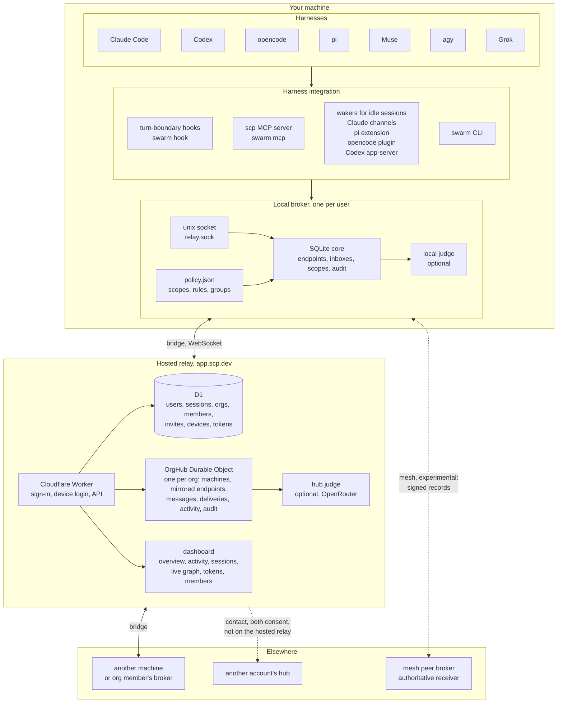
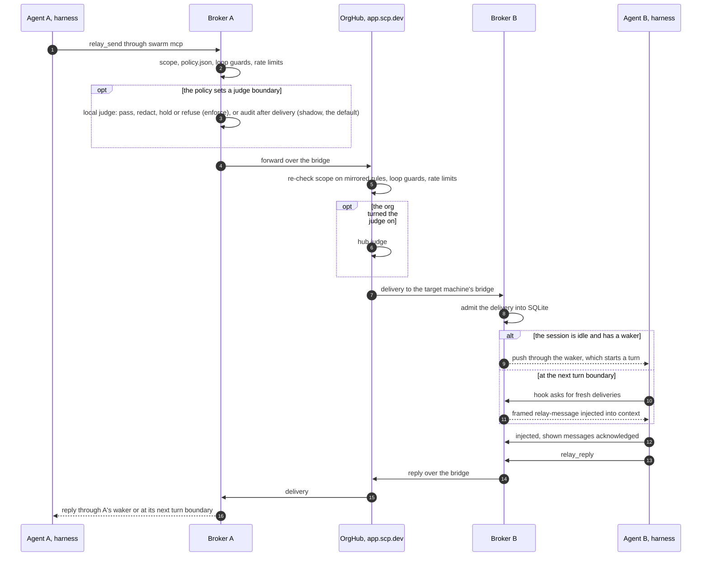

# Architecture

SCP has three layers. Harnesses connect to a local broker on their machine, the broker links to its org's hub over a bridge, and the hub forwards between machines. The normative description is [section 4 of the specification](/spec#4-architecture).

## The pieces

- **Harnesses.** Claude Code, Codex, opencode, pi, Muse, agy and Grok. Each integration other than pi installs turn-boundary hooks, which run `swarm hook <harness>` and inject messages after a tool call, on a prompt or at a stop, and registers the MCP server `scp` (`swarm mcp`) for sending, replying and reading the inbox. Grok reuses the Claude Code hooks, and opencode and Muse load theirs from a plugin. pi gets the tools and a waker from its extension instead.
- **Wakers.** An idle session has no turn boundary, so some harnesses get a waker: Claude channels (`swarm claude`), the pi extension (`swarm pi`), the opencode plugin, and the Codex app-server launcher (`swarm codex`). Each pushes a message in and starts a turn. Separately, while workers a session started are still running, the stop hook of Claude Code, Codex, Grok and Muse waits up to 600 s for their next message or handback.
- **Local broker.** One daemon per user on each machine, serving a unix socket (`relay.sock`). It keeps endpoints, inboxes, scopes, grants and audit in SQLite, reads its rules, groups and judge settings from `~/.config/scp/policy.json` on every send, and can run a local judge. The `swarm` CLI talks to the same socket. With `--cloud` or `SCP_TRANSPORT=cloud`, its messaging commands go straight to the hub, and the hooks then stay off.
- **Bridge.** The broker's authenticated WebSocket to its org's hub (`/v1/relay/ws`). It mirrors endpoints and their activity events, forwards sends to other machines, and takes the hub's deliveries for this machine. A `redact` setting keeps the working directory, title, status notes and activity summaries off the hub.
- **Hosted relay.** A Cloudflare Worker with D1 for users and their sign-in sessions, orgs, members and invites, device credentials, API tokens and each org's judge flag, and one `OrgHub` Durable Object per org that runs the hub in its own SQLite. It holds machines, mirrored endpoints, messages between machines until they expire, deliveries, activity events (tool names and short summaries), audit, held messages, and an hour of sender and recipient pairs. Messages between endpoints of one machine never reach it. The hosted relay lifts the hub's own caps on machines, endpoints, sockets, call rates and stored bytes. An org owner can turn on the hub judge; it runs only when the relay deployment sets a model and a key, with OpenRouter as the default provider. The dashboard has tabs for each org's overview, activity, sessions, a live graph, tokens and devices, and members; on the members tab an owner turns the judge on, and owners and admins review held messages. The graph and its live stream carry addresses, kinds, presence and message counts, never a body.
- **Contacts.** Two accounts' hubs talk only through a contact both accepted, with a per-side allowlist ([section 14.3](/spec#14-3-contacts)). The hub package implements contacts, but the hosted relay does not enable them, so an address of another account is not found there.
- **Mesh, experimental.** Brokers of one account can instead peer directly over WebSocket, exchanging signed machine records. Each receiving broker is the authority for its own endpoints ([section 14.8](/spec#14-8-mesh-experimental-non-normative)).

## One message, end to end

1. The agent calls an MCP tool such as `relay_send`, or runs `swarm send`. The integration sends a `send` request over the local socket.
2. The broker resolves the recipients and checks scope, policy, loop guards and rate limits. Where a judge boundary applies, the local judge runs: before delivery in enforce mode, or after delivery in shadow mode (the default), for the audit only.
3. For a recipient on another machine, the bridge forwards the send to the hub, which re-checks scope against the rules it mirrors, the loop guards and the rate limits, and runs the hub judge if the org turned it on.
4. The hub stores a delivery for the target machine, and that machine's bridge admits it into its broker.
5. An idle session with a waker gets the message pushed in, and a turn starts. Otherwise the next hook asks the broker for fresh deliveries, prints them inside untrusted framing and confirms what it showed.
6. A reply travels the same path back. A reply to a message the replier received is admitted even where scope would otherwise refuse it.
